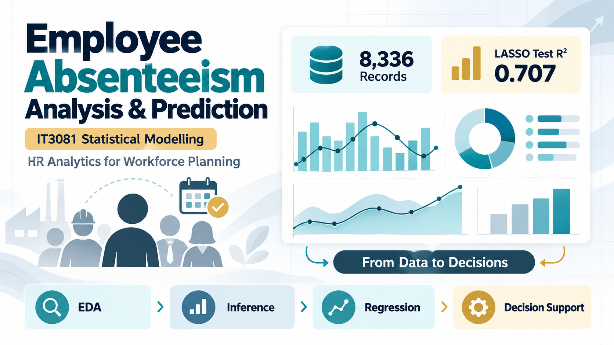

# Employee Absenteeism Analysis and Prediction

Statistical modelling consultancy project for analysing employee absenteeism in a Human Resources and manufacturing context. The project investigates absenteeism patterns, group differences, predictive model performance, and a responsible decision-support framework for workforce planning.

This work was completed for **IT3081 - Statistical Modelling** under the **BSc (Hons) Data Science** degree programme at the Department of Computer Science, Faculty of Computing, Sri Lanka Institute of Information Technology (SLIIT).



## Repository Description

An R-based statistical modelling consultancy project that analyses employee absenteeism using exploratory analysis, statistical inference, regression modelling, PCA evaluation, sensitivity analysis, and ethical HR decision-support recommendations.

## Project Objectives

- Analyse employee absenteeism patterns using `AbsentHours`.
- Validate the dataset and identify data-quality concerns.
- Explore relationships between absenteeism and employee/workforce variables.
- Test statistically significant group differences across organizational categories.
- Compare predictive models including Multiple Linear Regression, Ridge, LASSO, and Elastic Net.
- Evaluate PCA, Bayesian methods, experimental design, and time-series suitability.
- Propose an ethical workforce decision-support framework for HR and operations teams.

## Dataset

The analysis uses `data/raw/MFGEmployees4.csv`.

| Item | Details |
|---|---|
| Records | 8,336 |
| Variables | 13 |
| Target variable | `AbsentHours` |
| Context | HR analytics and manufacturing workforce planning |
| Data type | Cross-sectional employee records |

The dataset contains employee identifiers and names in the raw file, but these fields are excluded from modelling. This project treats results as statistical associations and predictive evidence, not as proof of causality.

## Key Findings

- Mean absent hours: **61.284**
- Median absent hours: **56.006**
- Zero-absence records: **15.83%**
- Age and absent hours showed a strong observed association: **Pearson r = 0.8302**
- Significant group differences were found across gender, department, division, and business unit.
- LASSO achieved the best full-dataset held-out performance:
  - Test MAE: **20.446**
  - Test RMSE: **26.215**
  - Test R2: **0.707**

These findings should be interpreted carefully because the data are observational and contain some flagged quality issues, including implausible age records and one service-age inconsistency.

## Methods Used

- Data validation and quality auditing
- Descriptive statistics
- Exploratory data analysis
- Correlation analysis
- Welch tests and Kruskal-Wallis tests
- Multiple Linear Regression
- Ridge Regression
- LASSO Regression
- Elastic Net Regression
- Model diagnostics and residual analysis
- Principal Component Analysis evaluation
- Sensitivity analysis
- Critical evaluation of Bayesian, experimental design, and time-series approaches

## Repository Structure

```text
.
├── R/
│   ├── main.R
│   └── README.md
├── data/
│   └── raw/
│       └── MFGEmployees4.csv
├── outputs/
│   ├── figures/
│   ├── models/
│   ├── statistical_results/
│   ├── tables/
│   └── Employee_Absenteeism_Consultancy_Final_Report.pdf
├── report/
│   ├── consultancy_report.md
│   ├── conceptual_framework.md
│   ├── recommendations.md
│   ├── literature_review.md
│   ├── citation_audit.md
│   ├── task_mapping.md
│   ├── presentation.md
│   ├── expert_feedback_template.md
│   └── viva_questions.md
├── Research Papers/
├── assets/
│   ├── linkedin-employee-absenteeism-poster.png
│   └── linkedin-employee-absenteeism-poster-option-2.png
├── PROJECT_OVERVIEW.md
├── GITHUB_PUBLISHING_GUIDE.md
├── LinkedIn_Post_Draft.md
└── README.md
```

## How to Run the Analysis

Install the required R packages:

```r
install.packages(c(
  "readr",
  "dplyr",
  "tidyr",
  "tibble",
  "ggplot2",
  "jsonlite",
  "glmnet"
))
```

Run the full pipeline from the project root:

```bash
Rscript R/main.R
```

The script generates tables, figures, model summaries, diagnostics, and JSON summaries inside the `outputs/` folder.

## Main Outputs

- Final report: `outputs/Employee_Absenteeism_Consultancy_Final_Report.pdf`
- Summary results: `outputs/statistical_results/final_summary.json`
- Model comparison: `outputs/tables/model_comparison.csv`
- Hypothesis testing results: `outputs/tables/hypothesis_results.csv`
- Regression diagnostics: `outputs/tables/regression_diagnostics.csv`
- Visualizations: `outputs/figures/`
- LinkedIn showcase posters: `assets/`

## Innovation Proposal

The project proposes the **Employee Absenteeism Risk Intelligence and Decision Support Framework**, a privacy-aware analytics framework for HR and operations teams. It is designed to support aggregate workforce planning, data-quality monitoring, model validation, fairness checks, and supportive interventions.

The framework is not intended for automatic disciplinary action or individual employee surveillance.

## Ethical Notes

This project should be used for academic and analytical purposes only. Employee absenteeism predictions must not be used as the sole basis for discipline, dismissal, promotion, or denial of opportunity. Any real-world implementation would require privacy safeguards, human oversight, access control, fairness monitoring, and organizational approval.

## Author

Group members:

- Lakshitha Dilshan J K P
- Nirmani K.H.D.T
- Palliyaguruge C.T
- Senaratne P.A.R.T

## Acknowledgement

This project was completed for the IT3081 - Statistical Modelling module at SLIIT.
