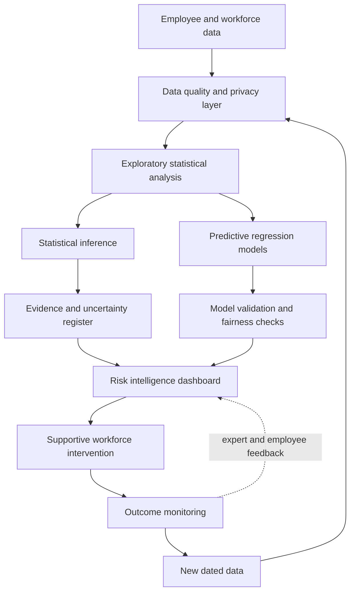

# Employee Absenteeism Risk Intelligence and Decision Support Framework

## Proposed solution

The proposed innovation is the **Employee Absenteeism Risk Intelligence and Decision Support Framework**. It is a privacy-aware analytics service that converts employee and workforce records into aggregate absenteeism insights, validated predictions, and supportive management actions.

The framework is designed for HR and operations management rather than automatic employee surveillance. Its primary decision unit should be the department, division, business unit, or location. Individual-level scores, if ever considered, require separate governance approval, strong justification, access restriction, explanation, and human review.

## Business need

The organization needs to understand where absenteeism pressure is concentrated, which observable characteristics are associated with `AbsentHours`, and how staffing or wellbeing resources could be allocated. A static report is insufficient because managers need recurring monitoring, uncertainty information, model-performance checks, and a feedback mechanism.

The current analysis shows that the available data can support descriptive group comparisons and predictive modelling, but it cannot establish causality or genuine time trends. The solution therefore combines current evidence with a data-collection roadmap for dated absenteeism records.

## Solution components

1. **Data layer:** collect only necessary employee and organizational variables; preserve the raw source and record data lineage.
2. **Quality and privacy layer:** check impossible ages, service inconsistencies, duplicates, missingness, outliers, access permissions, and retention rules.
3. **Statistical insight layer:** produce distributions, group summaries, robust tests, correlations, effect sizes, and uncertainty intervals.
4. **Prediction layer:** compare interpretable regression with regularised models and report cross-validation and held-out performance.
5. **Risk segmentation layer:** classify aggregate operational pressure into monitoring bands such as stable, watch, and priority, using validated thresholds rather than arbitrary individual labels.
6. **Dashboard layer:** show department-level absenteeism, group comparisons, model drivers, uncertainty, data-quality warnings, and recommended supportive actions.
7. **Intervention layer:** connect findings to staffing review, workload assessment, wellbeing support, scheduling review, and resource allocation.
8. **Monitoring layer:** track outcomes, model drift, subgroup performance, fairness, false positives, missingness, and user feedback.

## Dashboard design

The management dashboard should contain:

- **Executive view:** organization-wide mean, median, zero-absence proportion, data-quality status, and current model performance.
- **Department view:** department counts, mean and median `AbsentHours`, uncertainty intervals, sample sizes, and comparison warnings for small groups.
- **Workforce planning view:** staffing pressure, locations or units requiring operational review, and scenario notes.
- **Driver view:** validated model coefficients or importance proxies with plain-language interpretation and a clear association-not-causation warning.
- **Governance view:** missingness, flagged records, fairness checks, drift indicators, access logs, model version, and last review date.

The dashboard should avoid displaying names, surnames, or raw individual predictions by default. It should support decision-making at an organizational level and provide links to data-quality and model documentation.

## Expected benefits

### Strategic benefits

- Evidence-based workforce planning instead of uniform interventions.
- Earlier identification of department-level staffing pressure.
- Better alignment between HR, operations, wellbeing, and resource decisions.
- A repeatable analytical process that can be updated when dated records become available.

### Operational benefits

- Faster identification of unusual group patterns.
- More targeted review of workload, scheduling, staffing, and working conditions.
- Consistent reporting of uncertainty and data-quality limitations.
- Reduced risk of selecting a model solely because it has the lowest prediction error.

### Employee and organizational benefits

- Greater emphasis on supportive interventions rather than punishment.
- Transparent model limitations and human oversight.
- Opportunity to correct inaccurate employee records.
- Better evidence for evaluating future absenteeism-reduction interventions.

## Implementation roadmap

| Phase | Activities | Deliverable |
|---|---|---|
| 1. Governance and discovery | Confirm business owner, permitted uses, data access, retention, and employee safeguards | Approved use and governance register |
| 2. Data foundation | Add dated absence records, define measures, validate existing fields, and document lineage | Quality-controlled data model |
| 3. Analytical pilot | Re-run descriptive analysis, inference, models, sensitivity checks, and subgroup fairness checks | Validated pilot report |
| 4. Dashboard pilot | Build role-based aggregate dashboard with uncertainty and warnings | HR/operations pilot dashboard |
| 5. Intervention evaluation | Select supportive actions and evaluate them using CRD or RCBD where ethical and feasible | Intervention evaluation report |
| 6. Monitoring and update | Review drift, outcomes, fairness, data quality, and stakeholder feedback | Model monitoring and update cycle |

## Required resources

- **People:** HR subject-matter owner, operations representative, data analyst/statistician, data engineer, dashboard developer, privacy or ethics reviewer, and employee representative where appropriate.
- **Data:** validated employee master data, dated absence records, department/location structure, staffing counts, and intervention records where lawful and necessary.
- **Technology:** secure data storage, R analytical environment, version control, dashboard platform, role-based access control, and audit logging.
- **Process:** data dictionary, model card, approval workflow, incident response process, review calendar, and employee correction mechanism.
- **Time:** staged pilot delivery followed by monitored expansion; exact cost requires organizational estimates and should not be fabricated in the report.

## Implementation challenges and controls

| Challenge | Risk | Control |
|---|---|---|
| Implausible or incomplete records | Biased results and wrong interventions | Automated validation, manual review, sensitivity analysis, and correction workflow |
| Small organizational groups | Unstable estimates and misleading rankings | Minimum sample warnings, aggregation, confidence intervals, and suppression rules |
| Model drift | Performance deterioration as workforce conditions change | Scheduled validation and trigger-based retraining |
| Algorithmic bias | Unequal treatment or discriminatory decisions | Subgroup performance checks, human review, and prohibited-use policy |
| Privacy and surveillance concerns | Loss of trust and inappropriate employee monitoring | Data minimization, role-based access, aggregation, transparency, and retention limits |
| Causal overinterpretation | Punitive or ineffective action | Association language, uncertainty display, and intervention evaluation |
| Adoption resistance | Dashboard ignored or misused | Co-design with HR and operations, training, feedback, and clear accountability |

## Organizational impact

The framework changes absenteeism management from periodic descriptive reporting to a governed decision-support process. HR gains a structured way to identify support needs, operations gains better evidence for staffing and workload planning, and senior management gains a repeatable view of risk and uncertainty. The organization also accepts new responsibilities: it must protect employee privacy, explain analytical outputs, monitor fairness, and ensure that predictions do not become automatic disciplinary decisions.

## Success measures

The pilot should be evaluated using:

- Data-quality issue detection and resolution rate.
- Dashboard adoption by intended management users.
- Forecast or prediction error on future held-out records.
- Stability of model performance across departments and time periods.
- Change in staffing-planning response time.
- Number and outcome of supportive interventions.
- Employee and manager feedback.
- Privacy incidents, inappropriate-access events, and model-governance exceptions.

Success should not be defined only as a reduction in recorded absenteeism. A reduction could reflect improved attendance, changed recording practices, or harmful pressure on employees. Interpretation requires operational, employee, and governance evidence together.

## Ethical operating rules

- Do not use predictions as sole evidence for discipline, dismissal, promotion, or denial of opportunity.
- Do not expose names or individual scores in the default management dashboard.
- Do not infer medical conditions or personal causes from the supplied variables.
- Allow employees and managers to challenge inaccurate data.
- Require human review for every consequential action.
- Reassess the framework when new variables, policies, or data sources are introduced.
